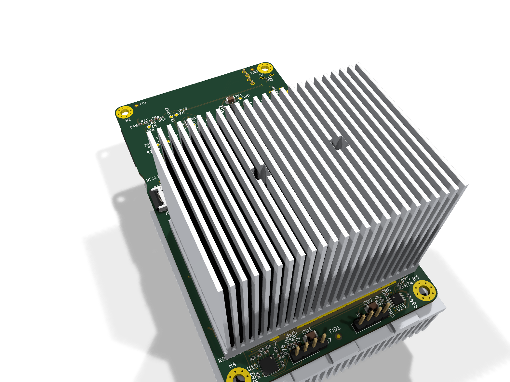
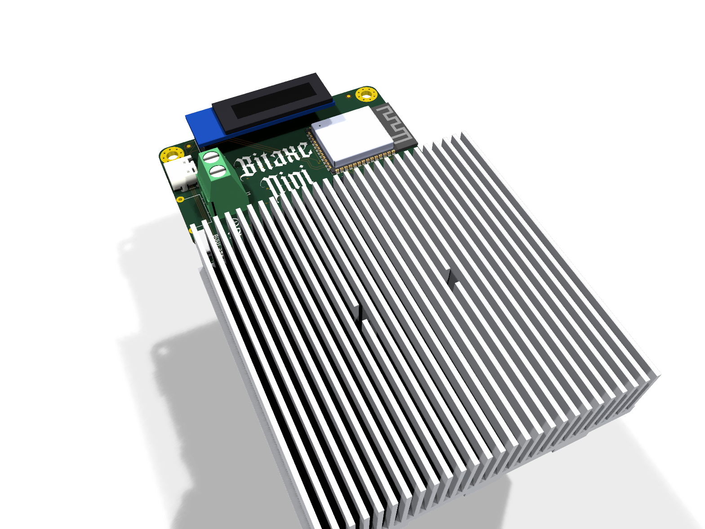

# Bitaxe Nini V2.0

Bitaxe Nini is an open-source Bitcoin miner board with **four KF1950 ASICs**. It is a derivative of the
[Bitaxe Gamma Turbo (BitaxeGT)](https://github.com/bitaxeorg/BitaxeGT) and is designed in KiCad 10.

 

## Features

- 4 x KF1950 ASICs on the bottom side, cooled by a ridged 68 x 68 mm heatsink
- TPS546D24S buck regulator for the ASIC core supply
- ESP32-S3-WROOM-1 controller with USB-C
- 12 V input (screw terminal J1, with an alternate J9 position)
- EMC2101 and EMC2103-2 fan control and temperature monitoring
- 0.91" 128 x 32 I2C OLED module (J4)
- Top-side heat spreading: exposed copper pours and filled thermal vias under a 60 x 44 x 44 mm finned heatsink
  (mounted on electrically insulating thermal tape), plus a 12 x 12 x 5 mm heatsink on the regulator
- 65.1 x 112.1 mm, 4-layer, 2 oz outer copper, ENIG, filled and capped via-in-pad

Firmware: [kuenrg153/ESP-Miner](https://github.com/kuenrg153/ESP-Miner), the ESP-Miner fork for the KF1950.

## Repository layout

| Path | Contents |
|---|---|
| `BitaxeNini_V2.0.kicad_pro` / `.kicad_sch` / `.kicad_pcb` | KiCad project, schematics (ASIC, Power, ESP32, fan sheets) and board |
| `bitaxe.kicad_sym`, `bitaxe.pretty/`, `3d/` | Project library: symbols, footprints and 3D models (bundled, no external library needed) |
| `Manufacturing Files/` | Gerbers, drill files, BOM with DigiKey part numbers, pick-and-place, fab and assembly drawings, `FAB_NOTES.txt` |
| `BitaxeNini_V2.0.step` | Full 3D assembly model |
| `doc/` | Renders |

The project library is referenced through `${KIPRJMOD}`, so the project opens with all footprints and 3D models
straight after cloning.

## Manufacturing

Upload `Manufacturing Files/BitaxeNini_V2.0_MFG_261119.zip` to the board house and include the notes in
`Manufacturing Files/FAB_NOTES.txt`. Key requirements: via-in-pad filled and capped (IPC-4761 Type VII) and the
intentional front solder-mask openings. The KF1950 ASICs are not sold by distributors and are supplied separately.

## License

This project is licensed under the
[CERN Open Hardware Licence Version 2 - Strongly Reciprocal (CERN-OHL-S-2.0)](https://choosealicense.com/licenses/cern-ohl-s-2.0/).
See [LICENSE](LICENSE) for the full text.

## Acknowledgments

- [bitaxeorg/BitaxeGT](https://github.com/bitaxeorg/BitaxeGT), the design this board is derived from
- [esp-miner](https://github.com/bitaxeorg/esp-miner) and the Bitaxe open-source community
- The OLED footprint reference: [MichMich/KiCad-SSD1306_OLED-0.91-128x32](https://github.com/MichMich/KiCad-SSD1306_OLED-0.91-128x32)
